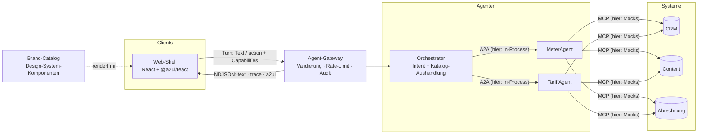

# A2UI React Sample – Beispiel-Architektur

Lauffähiges Sample zur **Beispiel-Architektur** aus dem Workshop-Board „Workshop: A2UI“.
Ein Kundenservice-Agent antwortet nicht nur mit Text, sondern mit **A2UI-Oberflächen**:
Das sind Formulare und Karten, die der Agent als JSON beschreibt. Die React-Web-Shell rendert sie mit den
Komponenten des (Multi-Brand-)Design-Systems.

> Protokoll: **A2UI v0.9** über den offiziellen Renderer `@a2ui/react` (0.15, Import-Pfad `v0_9`).
> A2UI 1.0 ist seit 11.11.2026 stabil, der React-Renderer bietet aber noch keinen `v1_0`-Pfad an.
> Mehr dazu unter [Weg zu A2UI 1.0](#weg-zu-a2ui-10).

## Schnellstart

```bash
npm install
npm run dev        # Gateway (http://localhost:8787) + Web-Shell (http://localhost:5173)
```

Öffne http://localhost:5173 und probiere:

| Eingabe | Was passiert |
|---|---|
| **Zählerstand melden** | Formular mit lokaler Validierung (`checks`). Der Server prüft ein zweites Mal (z. B. Wert < letzter Stand → Warnung). |
| **Tarife vergleichen** | Liste aus einem Daten-Template (`List` + relative Pfade). Der Wechsel geht nur mit **ausdrücklicher Bestätigung** (Guardrail). |
| **Hallo** | Unklare Anfrage: Der Orchestrator zeigt Buttons zur Auswahl. |
| Schalter **Marke** | Gleiche Agenten-Antwort, anderes Branding: Die Marke kommt nur über Tokens, der Agent weiß davon nichts. |
| Schalter **A2UI** aus | Der Client meldet keine Kataloge, der Agent antwortet nur mit Text (Zählerstand funktioniert auch per Chat). |
| Schalter **Ablauf** | Zeigt den Weg jeder Anfrage: Katalog-Aushandlung → A2A → MCP. |

Weitere Befehle:

```bash
npm test               # 16 Tests (Validierung, Agenten-Flows, Gateway über HTTP)
npm run typecheck      # TypeScript über alle Pakete
npm run build          # Produktions-Build der Web-Shell
npm run catalog:export # Marken-Katalog als JSON (für Registry oder LLM-Prompt)
```

Voraussetzung: Node.js ≥ 20. Ein API-Key wird nicht gebraucht, die Agenten sind deterministisch.

## Architektur



| Board-Element | Im Code | Umsetzung im Sample |
|---|---|---|
| Web-Shell (React) | `apps/web-shell` | Vite + React 19, `MessageProcessor` + `A2uiSurface` |
| Multi-Brand Design System | `packages/brand-catalog` | Basiskatalog + `BrandHeader` + `StatusBanner`, zwei Marken als Token-Sets |
| Katalog-Registry | `npm run catalog:export` | Katalog-JSON mit ID `https://design-system.example.com/…` (Platzhalter) |
| Agent-Gateway (AG-UI) | `services/gateway` | Node-HTTP, NDJSON-Stream, Validierung, Text-Fallback, Rate-Limit, Audit-Log |
| Orchestrator-Agent | `services/agents/src/orchestrator.ts` | Intent per Regeln (Platzhalter für ein LLM), Katalog-Aushandlung, Routing von Actions |
| Fach-Agenten (A2A) | `services/agents/src/agents/*` | `MeterAgent`, `TariffAgent`, gleiche Schnittstelle wie ein A2A-Service |
| Systeme (MCP-Tools) | `services/agents/src/mcp/tools.ts` | Mocks mit MCP-tauglichen Signaturen |
| MFE-Remotes, iOS, Android | – | nicht im Sample, siehe [Erweitern](#erweitern) |

### Ablauf am Beispiel Zählerstand

1. Die Web-Shell schickt `{"type":"text","text":"Zählerstand melden"}` und ihre Capabilities
   (`supportedCatalogIds`: Marken-Katalog, Basiskatalog) ans Gateway.
2. Der Orchestrator wählt den besten gemeinsamen Katalog und erkennt den Intent. Dann delegiert er an den `MeterAgent`.
3. Der `MeterAgent` holt Kunde und Zähler (`crm.getCustomer`) und streamt `createSurface` → `updateComponents` → `updateDataModel`.
4. Das Gateway prüft jede Nachricht: Version, Katalog, IDs, Verweise und die Obergrenze an Komponenten.
5. Im Browser validiert der `MessageProcessor` erneut gegen das v0.9-Schema und rendert mit dem Marken-Katalog.
   Die `checks` (`required`, `regex`) laufen lokal, der Button bleibt gesperrt, solange die Eingabe ungültig ist.
6. Der Klick auf „Senden“ erzeugt eine `action` (`submitMeterReading`, Kontext aus dem Datenmodell). Der Orchestrator
   leitet sie an den Besitzer der Surface weiter, der Agent prüft serverseitig und antwortet mit `updateComponents`.

## Projektstruktur

```
packages/
  shared/          Protokoll- und API-Typen (A2UI v0.9, Gateway-Events), Katalog-IDs
  brand-catalog/   Design-System-Komponenten (Zod-Schema + React), Marken-Tokens, Katalog
services/
  agents/          Orchestrator, Fach-Agenten, UI-Builder, MCP-Tool-Mocks
  gateway/         HTTP-Server, Validierung, Audit
apps/
  web-shell/       React-App: Chat-Verlauf, Surfaces, Marken- und A2UI-Schalter
tests/             Vitest: Validierung, Agenten-Flows (inkl. offiziellem Processor), Gateway
```

## Bewusste Entscheidungen (zur Diskussion)

- **Ein Katalog, mehrere Marken:** Die Marke steckt nur in CSS-Tokens (`--a2ui-color-primary` …) und im React-Context.
  Die Alternative „ein Katalog je Marke“ wäre ein Eintrag mehr in `CATALOG_PREFERENCE`.
- **Design-System-Komponenten mit Fallback:** `brandHeader()` und `statusBanner()` in `services/agents/src/ui.ts`
  erzeugen Basis-Komponenten, wenn der Client den Marken-Katalog nicht kennt.
- **Zwei Validierungsstufen:** Das Gateway prüft zentral (Katalog, Struktur, Limits), der Renderer
  prüft das Schema. Was das Gateway blockt, wird durch einen Text-Hinweis ersetzt.
- **Nie dem Client vertrauen:** Werte aus Actions werden im Agenten neu geprüft (Zählerstand ≥ letzter Stand,
  Bestätigung passt zur Auswahl).
- **Bestätigung bei verbindlichen Aktionen:** Der Tarifwechsel braucht einen zweiten, ausdrücklichen Klick.
- **Datensparsamkeit:** `sendDataModel` ist nur beim Zählerstand-Formular an. Ins Datenmodell kommen nur die
  Felder, die die Oberfläche braucht.

## Erweitern

- **Echtes LLM statt Regeln:** `classifyIntent()` ersetzen. Für Agenten, die A2UI selbst erzeugen, bauen die A2UI-Agent-SDKs
  (u. a. Python `a2ui-agent-sdk`) den Prompt aus dem Katalog (`npm run catalog:export`) und korrigieren ungültige Ausgaben.
- **Echtes A2A:** Jeden `DomainAgent` als eigenen Service mit Agent Card betreiben. Der Orchestrator ruft ihn dann per A2A auf.
  A2UI-Nachrichten reisen als DataPart mit MIME-Type `application/a2ui+json`.
- **AG-UI statt eigenem NDJSON:** Die Gateway-Events entsprechen grob AG-UI. A2UI-Nachrichten würden dort als
  `CUSTOM`-Events übertragen.
- **Echte MCP-Server:** `createMockTools()` durch einen MCP-Client ersetzen. Die Tool-Namen sind schon so gewählt.
- **Microfrontends (Vue/Nuxt):** Den Lit-Renderer (`@a2ui/lit`) als Web Component im Remote nutzen und den Brand-Catalog
  dort ebenfalls registrieren.
- **iOS / Android:** Dieselben Agenten-Nachrichten mit den Renderern für SwiftUI bzw. Jetpack Compose nutzen. Die
  Komponenten `BrandHeader`/`StatusBanner` müssen dort mit gleichem Schema nachgebaut werden.
- **Produktion:** echte Authentifizierung im Gateway (Kunden-ID aus dem Token, nicht aus dem Body), Session-Store
  (z. B. Redis), Audit-Log an die Log-Pipeline, CSP und Limits für Komponenten und Payloads.

## Mit Claude Code weiterarbeiten

Das Projekt ist für [Claude Code](https://code.claude.com/docs) vorbereitet:

- `CLAUDE.md`: Befehle, Aufbau, Regeln und Stolperfallen (wird automatisch geladen)
- `.claude/settings.json`: Freigaben für Tests, Typecheck und Build; Nachfrage bei `npm install` und `git push`
- `.claude/skills/`:
  - `/verify`: Typecheck, Tests und Build (Claude Code führt ihn vor Commits aus)
  - `/new-domain-agent <Anliegen>`: neuer Fach-Agent mit Surface, Text-Fallback, Routing und Tests
  - `/new-ds-component <Name – Zweck>`: neue Design-System-Komponente inkl. Fallback und Katalog-Export
  - `a2ui-messages`: Kurzreferenz A2UI v0.9 (lädt automatisch beim Arbeiten an A2UI-JSON)

Ideen für den Einstieg: `/new-domain-agent Störung melden` oder „Baue den Lit-Renderer für ein Vue-Remote ein“.

## Weg zu A2UI 1.0

1.0 benennt unter anderem die Bindungen um (`{"@path": …}` statt `{"path": …}`) und fügt bidirektionale Function Calls
hinzu. `@a2ui/web_core` 0.15 enthält 1.0-Schemas bereits, der React-Renderer exportiert aber nur `v0_8`/`v0_9`.
Sobald ein `v1_0`-Pfad verfügbar ist, müssen vor allem `services/agents/src/ui.ts` (Bindungen, Versionsstring) und
die Importe in der Web-Shell angepasst werden.

## Hinweise

- Alle Daten, Marken und Tarife sind erfunden.
- Versionen sind fest gepinnt (`@a2ui/react` und `@a2ui/web_core` 0.15.0). Über `overrides` in der Root-`package.json`
  gibt es genau eine Kopie von `web_core`. Mehrere Kopien führen zu Typ- und Laufzeitfehlern.
